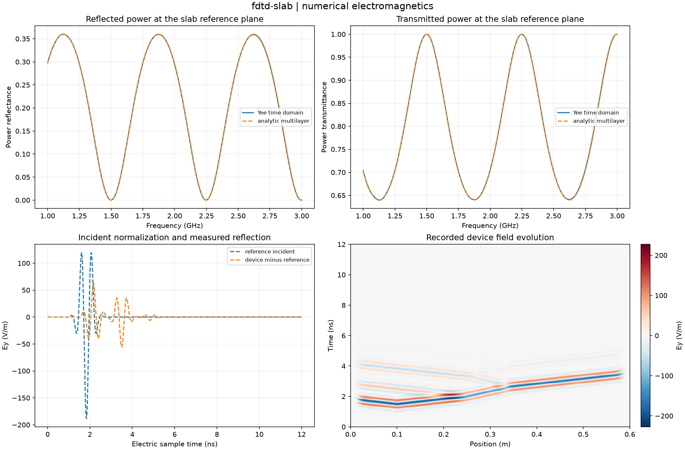
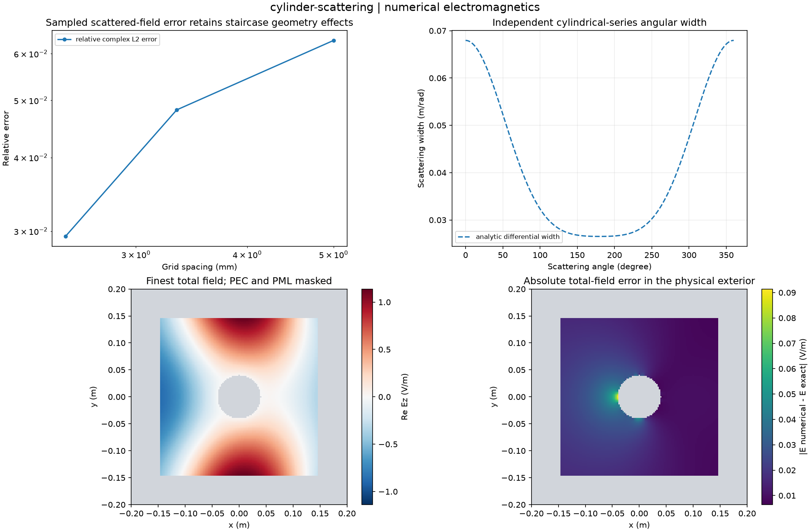
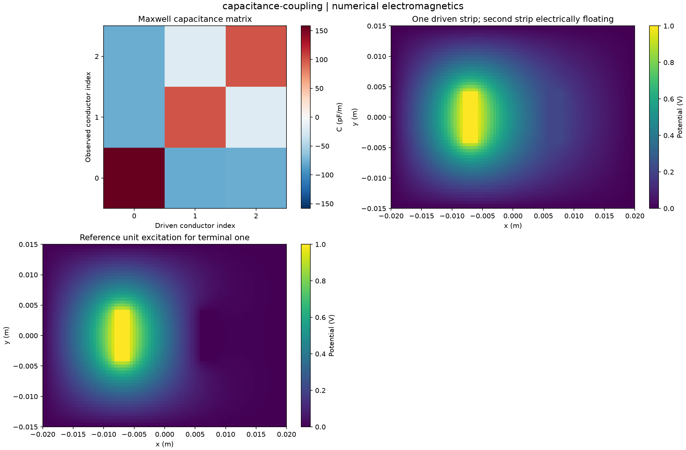
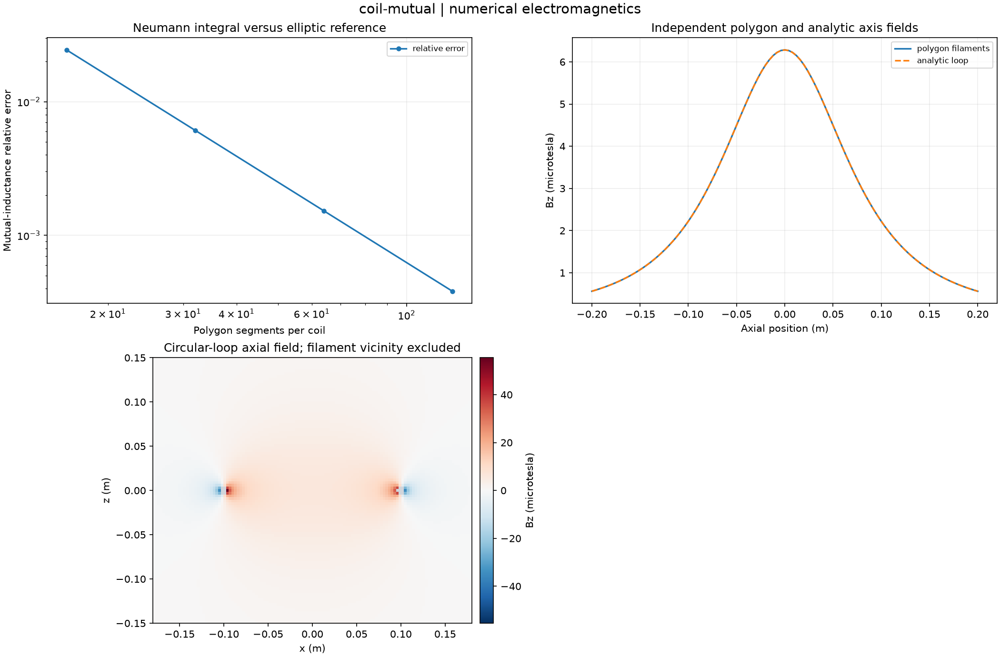
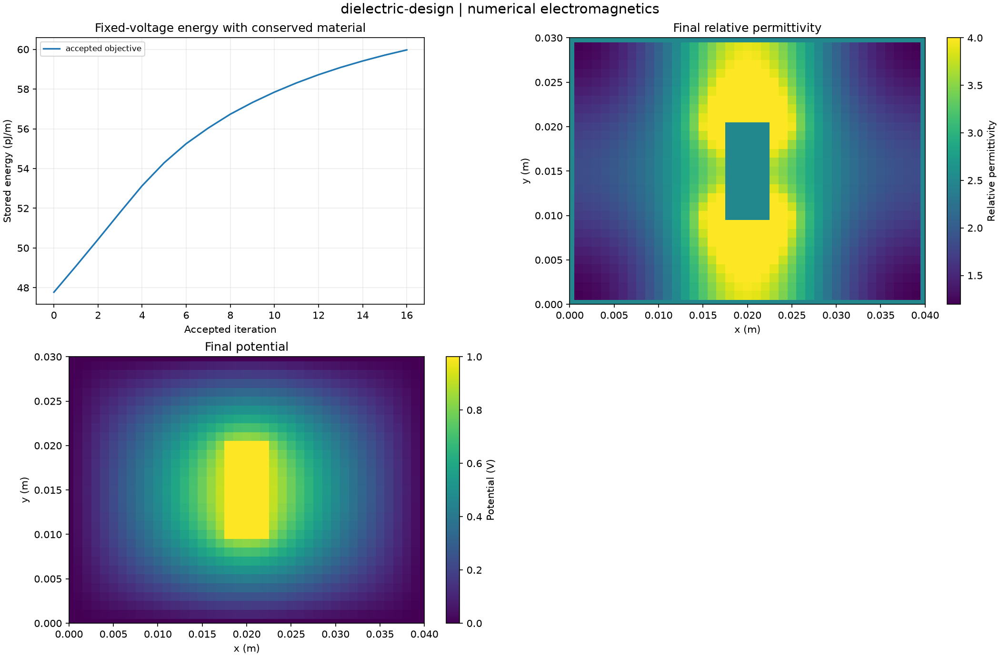

# Measured experiment gallery

Twenty-four default studies computed from clean source revision [`255b9ec96594`](https://github.com/VictorOdoyo/open-em-workbench/commit/255b9ec965941d1fc97a04b9f7e2101e959fbeca).
All values below come from the sealed captures. Each case directory contains the complete
NPZ arrays, CSV tables, parameters, provenance, plot and HTML report.

HTML files can be opened locally; GitHub previews the figures and tables directly.

| Study | Selected measured outputs | Artifacts |
| --- | --- | --- |
| [poisson-convergence](gallery/poisson-convergence/figure.png) | finest_relative_error = 0.000200822; maximum_solver_residual = 1.43146e-13 | [summary](gallery/poisson-convergence/summary.csv), [setup](gallery/poisson-convergence/parameters.json), [archive](gallery/poisson-convergence/fields.npz), [report](gallery/poisson-convergence/index.html) |
| [dielectric-interface](gallery/dielectric-interface/figure.png) | charge_capacitance_f_m = 7.03062e-12; discrete_series_reference_f_m = 7.03062e-12 | [summary](gallery/dielectric-interface/summary.csv), [setup](gallery/dielectric-interface/parameters.json), [archive](gallery/dielectric-interface/fields.npz), [report](gallery/dielectric-interface/index.html) |
| [capacitance-coupling](gallery/capacitance-coupling/figure.png) | field_energy_j_m = 4.77852e-11; floating_charge_c_m = 8.39594e-28 | [summary](gallery/capacitance-coupling/summary.csv), [setup](gallery/capacitance-coupling/parameters.json), [archive](gallery/capacitance-coupling/fields.npz), [report](gallery/capacitance-coupling/index.html) |
| [coax-convergence](gallery/coax-convergence/figure.png) | analytic_capacitance_f_m = 1.13937e-10; finest_capacitance_f_m = 1.10468e-10 | [summary](gallery/coax-convergence/summary.csv), [setup](gallery/coax-convergence/parameters.json), [archive](gallery/coax-convergence/fields.npz), [report](gallery/coax-convergence/index.html) |
| [multilayer-coating](gallery/multilayer-coating/figure.png) | design_reflectance = 1.9728e-32; maximum_power_balance_defect = 1.11022e-15 | [summary](gallery/multilayer-coating/summary.csv), [setup](gallery/multilayer-coating/parameters.json), [archive](gallery/multilayer-coating/fields.npz), [report](gallery/multilayer-coating/index.html) |
| [bragg-mirror](gallery/bragg-mirror/figure.png) | design_reflectance = 0.999024; design_transmittance = 0.000976086 | [summary](gallery/bragg-mirror/summary.csv), [setup](gallery/bragg-mirror/parameters.json), [archive](gallery/bragg-mirror/fields.npz), [report](gallery/bragg-mirror/index.html) |
| [absorbing-stack](gallery/absorbing-stack/figure.png) | layer_absorption_sum = 0.681377; maximum_joule_flux_defect = 1.43525e-07 | [summary](gallery/absorbing-stack/summary.csv), [setup](gallery/absorbing-stack/parameters.json), [archive](gallery/absorbing-stack/fields.npz), [report](gallery/absorbing-stack/index.html) |
| [microwave-lines](gallery/microwave-lines/figure.png) | design_matching_reflectance = 1.00307e-32; median_group_delay_s = 5.0034e-09 | [summary](gallery/microwave-lines/summary.csv), [setup](gallery/microwave-lines/parameters.json), [archive](gallery/microwave-lines/fields.npz), [report](gallery/microwave-lines/index.html) |
| [cavity-cutoffs](gallery/cavity-cutoffs/figure.png) | maximum_eigen_residual = 4.29484e-12; maximum_relative_cutoff_error = 0.000732338 | [summary](gallery/cavity-cutoffs/summary.csv), [setup](gallery/cavity-cutoffs/parameters.json), [archive](gallery/cavity-cutoffs/fields.npz), [report](gallery/cavity-cutoffs/index.html) |
| [slab-guidance](gallery/slab-guidance/figure.png) | analytic_effective_index = 1.46821; finest_effective_index = 1.46821 | [summary](gallery/slab-guidance/summary.csv), [setup](gallery/slab-guidance/parameters.json), [archive](gallery/slab-guidance/fields.npz), [report](gallery/slab-guidance/index.html) |
| [mode-perturbation](gallery/mode-perturbation/figure.png) | baseline_frequency_hz = 1.4562e+10; first_nonzero_prediction_relative_error = 0.00625845 | [summary](gallery/mode-perturbation/summary.csv), [setup](gallery/mode-perturbation/parameters.json), [archive](gallery/mode-perturbation/fields.npz), [report](gallery/mode-perturbation/index.html) |
| [coil-mutual](gallery/coil-mutual/figure.png) | analytic_mutual_h = 8.28499e-08; coaxial_attractive_force_n = -1.49405e-06 | [summary](gallery/coil-mutual/summary.csv), [setup](gallery/coil-mutual/parameters.json), [archive](gallery/coil-mutual/fields.npz), [report](gallery/coil-mutual/index.html) |
| [magnetostatic-current](gallery/magnetostatic-current/figure.png) | ampere_current_a = 1; ampere_relative_error = 3.55271e-15 | [summary](gallery/magnetostatic-current/summary.csv), [setup](gallery/magnetostatic-current/parameters.json), [archive](gallery/magnetostatic-current/fields.npz), [report](gallery/magnetostatic-current/index.html) |
| [fdtd-slab](gallery/fdtd-slab/figure.png) | final_device_peak_e_v_m = 0.0556636; maximum_absorption_error = 0.00152659 | [summary](gallery/fdtd-slab/summary.csv), [setup](gallery/fdtd-slab/parameters.json), [archive](gallery/fdtd-slab/fields.npz), [report](gallery/fdtd-slab/index.html) |
| [fdtd-debye](gallery/fdtd-debye/figure.png) | final_device_peak_e_v_m = 0.0484443; maximum_absorption_error = 0.000686517 | [summary](gallery/fdtd-debye/summary.csv), [setup](gallery/fdtd-debye/parameters.json), [archive](gallery/fdtd-debye/fields.npz), [report](gallery/fdtd-debye/index.html) |
| [fdtd-cavity](gallery/fdtd-cavity/figure.png) | continuum_frequency_hz = 1.67589e+09; continuum_frequency_relative_error = 6.01267e-05 | [summary](gallery/fdtd-cavity/summary.csv), [setup](gallery/fdtd-cavity/parameters.json), [archive](gallery/fdtd-cavity/fields.npz), [report](gallery/fdtd-cavity/index.html) |
| [fdtd-lossy-cavity](gallery/fdtd-lossy-cavity/figure.png) | continuum_frequency_hz = 1.18418e+09; continuum_frequency_relative_error = 5.81625e-05 | [summary](gallery/fdtd-lossy-cavity/summary.csv), [setup](gallery/fdtd-lossy-cavity/parameters.json), [archive](gallery/fdtd-lossy-cavity/fields.npz), [report](gallery/fdtd-lossy-cavity/index.html) |
| [fdtd-absorber](gallery/fdtd-absorber/figure.png) | cpml_return_amplitude = 7.71758e-08; mur_return_amplitude = 5.42943e-05 | [summary](gallery/fdtd-absorber/summary.csv), [setup](gallery/fdtd-absorber/parameters.json), [archive](gallery/fdtd-absorber/fields.npz), [report](gallery/fdtd-absorber/index.html) |
| [fdfd-line-source](gallery/fdfd-line-source/figure.png) | complex_field_relative_l2 = 0.00075386; solver_residual = 7.64992e-15 | [summary](gallery/fdfd-line-source/summary.csv), [setup](gallery/fdfd-line-source/parameters.json), [archive](gallery/fdfd-line-source/fields.npz), [report](gallery/fdfd-line-source/index.html) |
| [cylinder-scattering](gallery/cylinder-scattering/figure.png) | analytic_optical_theorem_defect_m = 0; analytic_scattering_width_m = 0.258475 | [summary](gallery/cylinder-scattering/summary.csv), [setup](gallery/cylinder-scattering/parameters.json), [archive](gallery/cylinder-scattering/fields.npz), [report](gallery/cylinder-scattering/index.html) |
| [dielectric-sensitivity](gallery/dielectric-sensitivity/figure.png) | maximum_relative_error = 3.34332e-07 | [summary](gallery/dielectric-sensitivity/summary.csv), [setup](gallery/dielectric-sensitivity/parameters.json), [archive](gallery/dielectric-sensitivity/fields.npz), [report](gallery/dielectric-sensitivity/index.html) |
| [maxwell-force](gallery/maxwell-force/figure.png) | finest_force_y_n_m = -8.98721e-08; finest_relative_error = 3.75462e-05 | [summary](gallery/maxwell-force/summary.csv), [setup](gallery/maxwell-force/parameters.json), [archive](gallery/maxwell-force/fields.npz), [report](gallery/maxwell-force/index.html) |
| [dielectric-design](gallery/dielectric-design/figure.png) | accepted_iterations = 16; capacitance_gain_fraction = 0.255317 | [summary](gallery/dielectric-design/summary.csv), [setup](gallery/dielectric-design/parameters.json), [archive](gallery/dielectric-design/fields.npz), [report](gallery/dielectric-design/index.html) |
| [manufacturing-uncertainty](gallery/manufacturing-uncertainty/figure.png) | linearized_std_f_m = 1.82474e-12; mean_ci95_high_f_m = 1.1407e-10 | [summary](gallery/manufacturing-uncertainty/summary.csv), [setup](gallery/manufacturing-uncertainty/parameters.json), [archive](gallery/manufacturing-uncertainty/fields.npz), [report](gallery/manufacturing-uncertainty/index.html) |

## Selected fields and diagnostics

### fdtd-slab

### cylinder-scattering

### capacitance-coupling

### coil-mutual

### dielectric-design

## Interpretation

Use each report's assumptions before interpreting the figures. Small algebraic residuals,
conservation defects and continuum errors are different diagnostics. Curved raster boundaries
can show nonmonotonic mesh error. PML targets are not measured reflection guarantees.
These outputs are simulations, not hardware measurements.

Reproduce with `emlab batch --data-only --output outputs/catalog`, then
`emlab render outputs/catalog` and `emlab verify outputs/catalog`.
Replay an individual archive with `emlab replay ARCHIVE --output DIRECTORY`.
Replay retains this source revision rather than claiming a fresh solve.
